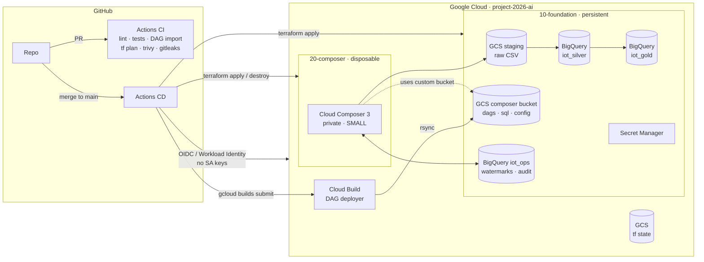
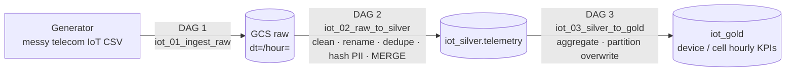
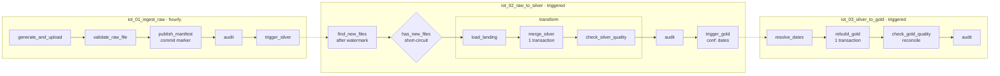
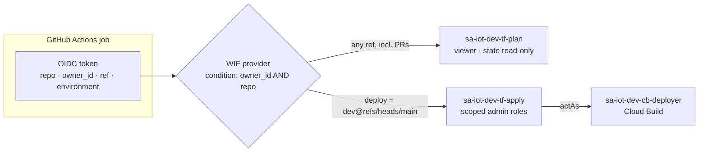

# IoT Telecom Data Platform (GCP)

Production-style, config-driven data platform for telecom IoT telemetry on Google Cloud.

**Step 1 goal:** a GitOps CI/CD pipeline that provisions a small **Cloud Composer 3** environment, runs three chained ETL DAGs (GCS → BigQuery silver → BigQuery gold), and can **destroy and recreate Composer** with no loss of DAGs, data, config or pipeline progress.

| | |
|---|---|
| **Status** | Step 1 · Phase E (ETL DAGs and SQL) ✅ |
| **Orchestrator** | Cloud Composer 3 · Airflow **3.3.1** (`composer-3-airflow-3.3.1-build.5`) |
| **Cloud** | GCP · `project-2026-ai` · `us-central1` |
| **Env config** | [`config/envs/dev.yaml`](config/envs/dev.yaml): one file drives Terraform, DAGs and the generator |
| **Command log** | [`docs/COMMANDS.md`](docs/COMMANDS.md): every command run to build this project |

---

## Architecture



### Why Composer can be deleted and recreated safely

| State | Lives in | Survives destroying Composer? |
|---|---|---|
| DAGs, SQL, config | Git → our own GCS bucket (`storage_config.bucket`) | ✅ |
| Raw data | GCS staging bucket (foundation layer) | ✅ |
| Silver / Gold tables | BigQuery (foundation layer) | ✅ |
| Pipeline progress | `iot_ops.watermarks` in BigQuery | ✅ |
| Airflow run history | Composer metadata DB | ❌ by design (optional snapshot) |

Terraform is split into layers with **separate state**, so `terraform destroy` on `20-composer` cannot touch data.

| Layer | Contents | Lifecycle |
|---|---|---|
| `00-bootstrap` | State bucket, APIs, Workload Identity Federation, CI service accounts | Once |
| `10-foundation` | Buckets, BigQuery datasets/tables, runtime SAs, IAM, VPC, secrets | Persistent (`prevent_destroy`) |
| `20-composer` | Cloud Composer 3 environment | Create / destroy on demand |

### Foundation layer: what exists (all from `config/envs/dev.yaml`)

| Resource | Name | Key settings |
|---|---|---|
| VPC and subnet | `iot-dev-vpc` / `iot-dev-composer-subnet` (10.10.0.0/24) | Private Google Access, flow logs (10% sampled), explicit deny-all ingress, **no NAT** (no egress) |
| Staging bucket | `project-2026-ai-iot-dev-staging` | UBLA, public-access prevention, Nearline after 30 days, deleted after 90 days |
| Composer bucket | `project-2026-ai-iot-dev-composer` | Versioned (last 5 versions kept), reused by every Composer instance |
| Cloud Build bucket | `project-2026-ai-iot-dev-cloudbuild` | Build source tarballs, deleted after 7 days. CI can write, the deployer can only read |
| BigQuery `iot_landing` | Transient load tables | Tables expire after 24 hours |
| BigQuery `iot_silver` | `telemetry` | Partitioned by `event_date`, clustered by `device_id, cell_id`, partition filter required |
| BigQuery `iot_gold` | `device_hourly_kpis`, `cell_hourly_kpis` | Partitioned by `event_date`, clustered, partition filter required |
| BigQuery `iot_ops` | `watermarks`, `batch_audit` | Pipeline state and audit, independent of Airflow |
| Secret | `iot-dev-pii-hash-salt` | Generated by an **ephemeral** resource and written through a **write-only** argument, so it never appears in Terraform state or plans |

**Tables as code.** Each `schemas/bigquery/<dataset>/<table>.json` holds the schema, descriptions, partitioning and clustering for one table:
- Terraform creates one table per file.
- The DAGs reuse the same files through `iot_pipeline.schemas`.
- Unit tests fail if `config` and `schemas/` drift apart.
- Every table has `deletion_protection`, and every dataset and bucket has `prevent_destroy`.

**Runtime access (`sa-iot-dev-composer`), granted per resource:**
- `objectUser` on the staging bucket
- `objectAdmin` on the Composer bucket
- `dataEditor` on each of the 4 datasets
- `secretAccessor` on the one secret
- project roles: `composer.worker`, `bigquery.jobUser`, log and metric writer

The Composer service agent's extension role is granted on the runtime SA itself, not project-wide. The Cloud Build deployer can write only `dags/`, `plugins/` and `data/` in the Composer bucket, enforced by an IAM condition.

`uv run python scripts/verify_foundation.py` is a read-only smoke test that checks the live resources against config.

### Data flow (medallion)



Each DAG triggers the next. Every task is **idempotent**: re-running an interval gives the same result. Loads are **incremental** from a watermark, so downtime or a Composer rebuild leaves no gaps.

### The three DAGs

Thin DAG files ([`dags/`](dags/)) wire together task functions from [`iot_pipeline.etl`](src/iot_pipeline/etl/). All logic is plain Python and SQL, so it can be unit-tested and run end to end without Airflow ([`scripts/run_etl_local.py`](scripts/run_etl_local.py)).



| Airflow / data concept | Where it's used |
|---|---|
| **Idempotency** | Deterministic batch → same object path and bytes; MD5-skip upload; `MERGE` on deterministic `event_id`; gold = delete and insert of the affected partitions; deterministic landing table and trigger run ids |
| **Incremental loading** | Watermark (manifest creation time) in `iot_ops.watermarks`, outside Airflow. It advances in the **same BigQuery transaction** as the merge and never moves backwards. Catch-up after downtime is capped by `max_files_per_run` |
| **Exactly-once effect under retries** | The file list travels by XCom, so a retried merge re-processes the same files; the result is the same rows |
| **Commit marker** | The manifest is written only after validation, and silver only reads files that have one |
| **Cross-DAG dependency** | `TriggerDagRunOperator` (deterministic `trigger_run_id`, `reset_dag_run`), plus Asset outlets for lineage |
| **Task dependencies** | TaskFlow API, explicit `>>`, `TaskGroup("transform")`, `@task.short_circuit` |
| **Config-driven defaults** | `default_args` (retries, exponential backoff, `execution_timeout`), `dagrun_timeout`, `max_active_runs=1`, `catchup`, tags: all from YAML |
| **Data quality** | Measured in SQL, judged in Python against config thresholds; `DataQualityError` gives `DQ_FAILED` in the audit log |
| **Observability** | Every task outcome goes to `iot_ops.batch_audit` (success via an `audit` task, failure via `on_failure_callback`), plus BigQuery job labels per DAG and task |
| **Resume after Composer is rebuilt** | `is_paused_upon_creation=False`; state lives in the watermark, the audit table and the buckets, not in the Airflow DB |

**Silver transformations** ([`02_merge_silver.sql`](sql/silver/02_merge_silver.sql)):
- **Renaming:** `timeStamp`→`event_ts`, `Battery %`→`battery_pct`, `Temp (C)`→`temperature_c`, `Long`→`longitude`, and so on.
- **Clean-up:**
  - "no value" tokens become NULL, and unit suffixes are stripped
  - 3 timestamp formats are parsed
  - radio-type aliases and device-type spellings are mapped to canonical values
  - IMEIs keep digits only, and firmware loses its `v` prefix
- **Data-quality flags:** valid ranges and the service area come from config, which catches swapped lat/long.
- **PII:** IMSI, MSISDN and IMEI are hashed with a salt, and the IMEI TAC is kept for model analytics.
- **De-duplication:** done by `event_id`.

**Verified against real BigQuery:**
- Of 5,505 raw rows, exactly the 160 injected duplicates were removed.
- 349 rows (6.5%) were flagged invalid.
- Gold reconciles to silver (4,996 = 4,996 events).
- A forced re-merge changed nothing, and the next run found 0 new files.

### Raw data: contract and generator

[`iot_pipeline.contracts`](src/iot_pipeline/contracts.py) is the source contract (v1.0): 22 messy raw headers, plus the sanitised all-STRING landing columns they map to. The generator, the landing schema file and the tests all import it, so they can't drift apart.

[`iot_pipeline.generator`](src/iot_pipeline/generator.py) produces one hourly batch per data interval (500–2,000 rows × 22 columns, from config).

| Aspect | What it does |
|---|---|
| **Realistic** | A stable 300-device fleet across 6 device types, with Luhn-valid IMEIs, IMSIs that start with MCC 310 + MNC 260/410, and US MSISDNs. LTE cells (ECI = eNB×256+sector) are grouped into tracking areas around 6 US metros. RSRP, RSRQ and SINR stay in physical ranges, battery drains over time, traffic depends on device type, and trackers roam between cells |
| **Messy on purpose** | Mixed header styles, 3 timestamp formats (ISO, epoch-ms, `YYYY-MM-DD HH:MM:SS`), unit suffixes (`-97 dBm`, `77%`, `31C`), null tokens (`N/A`, `null`, `NaN`, `-`, empty), aliases and casing (`LTE`/` lte `/`4g`, `SMART-METER`/`Smart Meter`), IMEIs with dashes, `v`-prefixed firmware, out-of-range values (battery 140%, RSRP +20, swapped lat/long), and ~3% exact duplicate rows |
| **Deterministic** | Seeded from `(env, interval)`, so a re-run produces byte-identical content at the same path `raw/iot_telemetry/dt=YYYY-MM-DD/hour=HH/part-<batch>.csv` |
| **Re-runs are no-ops** | Upload is skipped when the MD5 matches, so a re-run creates no new object |
| **Auditable** | One manifest per batch records the row count, MD5, header and how many anomalies of each kind were injected, so silver's cleaning can be checked against it |
| **Portable** | Standard library only, so it runs inside private Composer |

```bash
uv run python -m iot_pipeline.generator --start 2026-11-09T00:00:00Z --hours 3 --out ./output   # local
uv run python -m iot_pipeline.generator --start 2026-11-09T00:00:00Z --hours 3 --upload         # staging bucket
```

The helpers in [`gcs.py`](src/iot_pipeline/gcs.py) and [`bq.py`](src/iot_pipeline/bq.py) take clients as arguments, so the same code runs from the CLI, from Airflow hooks and from tests with fakes:
- MD5-aware upload
- typed BigQuery query parameters, so values are never formatted into SQL
- job labels for cost attribution
- a parameterised audit-log writer

## CI/CD identity model



| Identity | Who can use it | Can do | Cannot do |
|---|---|---|---|
| `tf-plan` | Any workflow in this repo (PRs) | Read the project and state (plan runs with `-lock=false`) | Write anything |
| `tf-apply` | Only jobs on `main` **and** in the `dev` GitHub Environment | Manage foundation and composer resources, and grant only the allow-listed roles | Grant Owner/Editor; write bootstrap state |
| `cb-deployer` | Cloud Build jobs submitted by `tf-apply` | Write logs (DAG bucket write is added in Phase C) | Anything else |

`00-bootstrap` holds the CI identities' own permissions, so it is applied **only by a human owner**:

```bash
uv run python scripts/tf.py bootstrap          # first run: local state -> GCS migration
uv run python scripts/tf.py plan bootstrap     # later: drift check
```

All other layers run through `scripts/tf.py <init|plan|apply|destroy> <foundation|composer>`. It reads the backend bucket and prefix from config, so nothing is typed by hand.

GitHub settings are also code ([`scripts/github_repo.py`](scripts/github_repo.py), idempotent):

| Setting | Value |
|---|---|
| Repo variables | `GCP_PROJECT_ID`, `GCP_REGION`, `GCP_WIF_PROVIDER`, `GCP_SA_*`, `TF_STATE_BUCKET`, `IOT_ENV`, read from Terraform outputs. No secrets exist |
| Environment `dev` | Owner approval required; only `main` may deploy |
| Ruleset on `main` | PR required, linear history (squash only), no force-push or deletion. CI status checks are added in Phase F |

## Security

- **No long-lived keys.** GitHub authenticates through Workload Identity Federation. The provider only accepts tokens from this repo, and apply only runs from `main` behind an approval environment.
- **One service account per job, with least privilege:**
  - `tf-plan` (read-only, PRs)
  - `tf-apply` (main + approval)
  - `cb-deployer` (writes only to the DAG bucket)
  - `composer` runtime (access only to the platform's buckets and datasets)
- **Private Composer.** It needs no internet or PyPI access: the library depends only on packages already in the Composer image.
- **PII** (IMSI, MSISDN) is SHA-256 hashed with a salt from Secret Manager in the silver layer. Raw data expires automatically.
- **Buckets:** uniform bucket-level access, public-access prevention enforced, versioning on state and DAGs.
- **Supply chain:** pinned dependencies, Dependabot, CODEOWNERS, `gitleaks`, `trivy`, branch protection.
- **Known limitation:** the PII salt reaches BigQuery as a query parameter, and parameters are visible in job metadata to principals who can list *all* project jobs (admins). It is never logged, put in XCom or stored in Terraform state. Planned hardening: Cloud KMS keysets with `DETERMINISTIC_ENCRYPT` / AEAD functions.
- **Not possible yet:** the project has no GCP Organization, so VPC Service Controls and org policies are deferred until it does.

## Repository layout

```
config/envs/          Environment config (single source of truth, validated by pydantic)
src/iot_pipeline/     Reusable library: config, contracts, schemas, generator, gcs, bq
schemas/bigquery/     Table definitions as code (<dataset>/<table>.json)
dags/                 3 thin Airflow 3 DAGs (+ .airflowignore for the bundled library)
sql/                  Versioned BigQuery SQL: silver/, gold/ (identifiers templated, values parameterised)
infra/terraform/      00-bootstrap · 10-foundation · 20-composer · modules (Phases B, C, G)
scripts/tf.py         Config-driven Terraform wrapper (backend + env injected from YAML)
scripts/github_repo.py  GitHub variables, environment and branch ruleset as code
scripts/verify_foundation.py  Read-only smoke test: live resources vs config
scripts/run_etl_local.py      Run DAG1→DAG2→DAG3 task functions locally against real GCP
cloudbuild/           Cloud Build configs (dag-tests.yaml: DAG integrity on Linux / Airflow 3.3.1)
.github/              Workflows, CODEOWNERS, Dependabot, PR template
tests/unit/           78 unit tests (no cloud, no Airflow)
tests/dags/           DAG integrity tests (real Airflow, Linux via Cloud Build)
docs/COMMANDS.md      Chronological log of every command run
```

## Local development

Requires [uv](https://docs.astral.sh/uv/), Terraform ≥ 1.9, gcloud.

```bash
uv sync                                   # create .venv (Python 3.11, matches Composer)
uv run pre-commit install                 # local quality gates
uv run pytest                             # unit tests
uv run python -m iot_pipeline.config validate config/envs/dev.yaml
```

> Airflow does not run natively on Windows. DAG import tests run in CI (Ubuntu, Python 3.11) or under WSL.

## Roadmap: Step 1

- [x] **A.** Repo foundation: config schema, tooling, governance
- [x] **B.** Terraform bootstrap: remote state, APIs, Workload Identity Federation, CI service accounts
- [x] **C.** Terraform foundation: buckets, BigQuery, runtime IAM, VPC, secrets
- [x] **D.** Library: data generator, GCS/BQ helpers
- [x] **E.** Three ETL DAGs and SQL
- [ ] **F.** GitHub Actions and Cloud Build pipelines
- [ ] **G.** Composer layer and an end-to-end run
- [ ] **H.** Destroy and recreate Composer, then confirm the pipeline resumes
