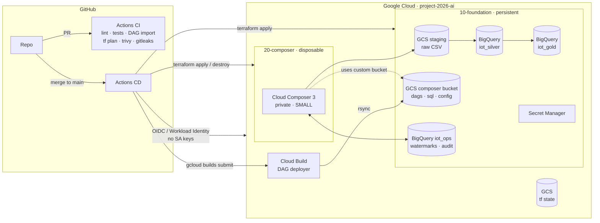
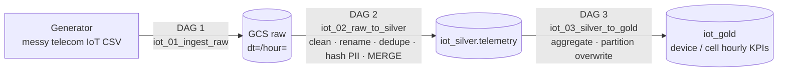
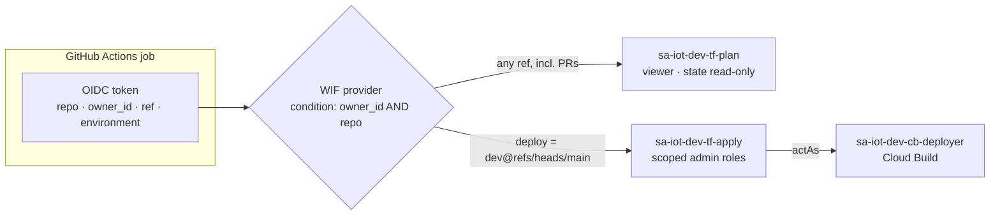

# IoT Telecom Data Platform (GCP)

Production-style, config-driven data platform for telecom IoT telemetry on Google Cloud.

**Step 1 goal:** a GitOps CI/CD pipeline that provisions a small **Cloud Composer 3** environment, runs three chained ETL DAGs (GCS → BigQuery silver → BigQuery gold), and can **destroy and recreate Composer** with no loss of DAGs, data, config or pipeline progress.

| | |
|---|---|
| **Status** | Step 1 · Phase B (Terraform bootstrap) ✅ |
| **Cloud** | GCP · `project-2026-ai` · `us-central1` |
| **Env config** | [`config/envs/dev.yaml`](config/envs/dev.yaml): one file drives Terraform, DAGs and the generator |
| **Command log** | [`docs/COMMANDS.md`](docs/COMMANDS.md): every command run to build this project |

---

## Architecture



### Why Composer can be deleted and recreated safely

| State | Lives in | Survives destroying Composer? |
|---|---|---|
| DAGs, SQL, config | Git → our own GCS bucket (`storage_config.bucket`) | ✅ |
| Raw data | GCS staging bucket (foundation layer) | ✅ |
| Silver / Gold tables | BigQuery (foundation layer) | ✅ |
| Pipeline progress | `iot_ops.watermarks` in BigQuery | ✅ |
| Airflow run history | Composer metadata DB | ❌ by design (optional snapshot) |

Terraform is split into layers with **separate state**, so `terraform destroy` on `20-composer` cannot touch data.

| Layer | Contents | Lifecycle |
|---|---|---|
| `00-bootstrap` | State bucket, APIs, Workload Identity Federation, CI service accounts | Once |
| `10-foundation` | Buckets, BigQuery datasets/tables, runtime SAs, IAM, VPC, secrets | Persistent (`prevent_destroy`) |
| `20-composer` | Cloud Composer 3 environment | Create / destroy on demand |

### Data flow (medallion)



Each DAG triggers the next. Every task is **idempotent**: re-running an interval gives the same result. Loads are **incremental** from a watermark, so downtime or a Composer rebuild leaves no gaps.

## CI/CD identity model



| Identity | Who can use it | Can do | Cannot do |
|---|---|---|---|
| `tf-plan` | Any workflow in this repo (PRs) | Read the project and state (plan runs with `-lock=false`) | Write anything |
| `tf-apply` | Only jobs on `main` **and** in the `dev` GitHub Environment | Manage foundation and composer resources, and grant only the allow-listed roles | Grant Owner/Editor; write bootstrap state |
| `cb-deployer` | Cloud Build jobs submitted by `tf-apply` | Write logs (DAG bucket write is added in Phase C) | Anything else |

`00-bootstrap` holds the CI identities' own permissions, so it is applied **only by a human owner**:

```bash
uv run python scripts/tf.py bootstrap          # first run: local state -> GCS migration
uv run python scripts/tf.py plan bootstrap     # later: drift check
```

All other layers run through `scripts/tf.py <init|plan|apply|destroy> <foundation|composer>`. It reads the backend bucket and prefix from config, so nothing is typed by hand.

## Security

- **No long-lived keys.** GitHub authenticates through Workload Identity Federation. The provider only accepts tokens from this repo, and apply only runs from `main` behind an approval environment.
- **One service account per job, with least privilege:**
  - `tf-plan` (read-only, PRs)
  - `tf-apply` (main + approval)
  - `cb-deployer` (writes only to the DAG bucket)
  - `composer` runtime (access only to the platform's buckets and datasets)
- **Private Composer.** It needs no internet or PyPI access: the library depends only on packages already in the Composer image.
- **PII** (IMSI, MSISDN) is SHA-256 hashed with a salt from Secret Manager in the silver layer. Raw data expires automatically.
- **Buckets:** uniform bucket-level access, public-access prevention enforced, versioning on state and DAGs.
- **Supply chain:** pinned dependencies, Dependabot, CODEOWNERS, `gitleaks`, `trivy`, branch protection.
- **Not possible yet:** the project has no GCP Organization, so VPC Service Controls and org policies are deferred until it does.

## Repository layout

```
config/envs/          Environment config (single source of truth, validated by pydantic)
src/iot_pipeline/     Reusable library: config loader, generator, GCS/BQ helpers
dags/                 Airflow DAGs (Phase E)
sql/                  Versioned BigQuery SQL (Phase E)
infra/terraform/      00-bootstrap · 10-foundation · 20-composer · modules (Phases B, C, G)
scripts/tf.py         Config-driven Terraform wrapper (backend + env injected from YAML)
cloudbuild/           Cloud Build configs (Phase F)
.github/              Workflows, CODEOWNERS, Dependabot, PR template
tests/                Unit tests (+ DAG integrity tests)
docs/COMMANDS.md      Chronological log of every command run
```

## Local development

Requires [uv](https://docs.astral.sh/uv/), Terraform ≥ 1.9, gcloud.

```bash
uv sync                                   # create .venv (Python 3.11, matches Composer)
uv run pre-commit install                 # local quality gates
uv run pytest                             # unit tests
uv run python -m iot_pipeline.config validate config/envs/dev.yaml
```

> Airflow does not run natively on Windows. DAG import tests run in CI (Ubuntu, Python 3.11) or under WSL.

## Roadmap: Step 1

- [x] **A.** Repo foundation: config schema, tooling, governance
- [x] **B.** Terraform bootstrap: remote state, APIs, Workload Identity Federation, CI service accounts
- [ ] **C.** Terraform foundation: buckets, BigQuery, runtime IAM, VPC, secrets
- [ ] **D.** Library: data generator, GCS/BQ helpers
- [ ] **E.** Three ETL DAGs and SQL
- [ ] **F.** GitHub Actions and Cloud Build pipelines
- [ ] **G.** Composer layer and an end-to-end run
- [ ] **H.** Destroy and recreate Composer, then confirm the pipeline resumes
